# AESPA — AI-Enabled Security Pentesting Agent

[](https://deepwiki.com/ledwardchow/aespa) 

## What is this?

An **exploration** into whether a fully LLM-driven, automated web application/API "penetration tests" could work.

## What should I use it for?

Testing :) It's got a cool UI and stuff.

**This is not a replacement for human testers; it can help you scale.** If you run an offensive security team and have a lot of websites/APIs you need to work through, running this first can help you prioritise what to put testers on.

## Features

Point-and-click SAST and DAST for web applications, optimised for cost.

Give it the source code of a web app via ZIP or GitHub checkout, and it'll spit out the findings.

You can feed those SAST findings into a DAST scan for better performance/less tokens spent finding things, or just do straight grey-box DAST without the source.

The DAST module will give you a lot of information about what is going on:

- What each agent is doing
- An OWASP coverage sheet, listing each URL route and discovered business process/workflow + what testing was undertaken against each

You will need to provide:

- For web app testing - URL and (optionally) credentials
- For API testing - documentation so that the scanner can understand the structure of the APIs in scope (OpenAPI YAML, text dumps of Confluence pages, markdown, free text files containing API credentials; just upload whatever you have and the scanner will figure it out!)
- (Optionally) ZIP of the source code for the web app/API. You can run SAST as a standalone operation or load the SAST findings into a web or API scan, which will validate the finding with dynamic testing
- An API key for a supported LLM provider, AWS credentials, a GitHub Copilot subscription, or a ChatGPT/Codex subscription with Codex installed separately

## Performance

Benchmarks are now on a dedicated website, [AESPA Benchmark](https://bench.aespa.app).

At time of writing (October 2026) this includes results for 24 models, including:

- TAC1 models GPT-6 Luna/Sol
- TAC3 model GPT-5.6-Cyber (as gpt-daybreak-red-latest)
- Claude Mythos 5
- Qwen 3.8 27b

The best performing models (cost/benefit) are:

- SAST: Qwen 3.8 27b (run locally), GPT-6 Luna
- DAST: Qwen 3.8 27b (run locally), GPT-6 Sol

## Documentation

[Changelog](CHANGELOG.md)

## Requirements

- Burp Suite Professional, if you want to use the active scan integration
- Access to a LLM service, AESPA supports most of them:
  - The Anthropic API
  - The OpenAI API
  - Any OpenAI-compatible API (including local LLMs)
  - OpenRouter
  - Google Gemini API
  - Google Vertex ADC
  - Azure OpenAI Service/Foundry
  - Amazon Bedrock Runtime/Mantle, via API key or IAM
  - Claude subscription (via Claude CLI) 
  - [Factory.AI](http://Factory.AI) subscription (via Droid CLI)
  - GitHub Copilot subscription (via Copilot CLI)
  - ChatGPT subscription (via Sign in with ChatGPT or Codex CLI). 
    - Note since 16 Oct 2026 I've experienced a large number of cyber refusals on "sign in with ChatGPT" on a Daybreak account, which didn't occur when using the Codex CLI provider. I can't explain it either, just something to be aware of if this happens to you.
  - Google Antigravity subscription (via agy CLI)

If your API key has TPM/RPM quota caps this is configurable in the LLM Settings UI. If left unconfigured i've seen this consume up to ~10m TPM bursts.

You will need to make sure your model is cyber-capable, i.e. doesn't have cyber refusals/you are part of the access program such as OpenAI Daybreak/Anthropic CVP/Google Fairwind.

If you aren't part of any, I recommend the following:

- Claude Sonnet 5 (doesn't seem to hit cyber refusals unless you type something sus on ALICE), usable results
- Qwen 3.8 27b, runs locally on a 64GB Macbook or 24GB CUDA card, this performs better than Sonnet 5
- GLM 5.3

## Running (macOS/Windows)

Standalone binaries for Windows and macOS are available at [GitHub releases](https://github.com/ledwardchow/aespa/releases). 

These versions run in the background in the menubar or systray - click on the icon to open the interface/quit the background process. 

Note the builds are automatic and I don't test these that often, the Mac one maybe I use a few times a month to check if it works, the Windows one... only when someone asks.

## Running with Docker

I don't recommend you use this, running it directly is much easier to troubleshoot.

The image bundles Chromium, so no separate Playwright install is needed.

### From a container registry

After the Windows and macOS desktop releases succeed on `main`, the build publishes the image to [Docker Hub](https://hub.docker.com/r/ledwardchow/aespa) and [GitHub Container Registry](https://github.com/ledwardchow/aespa/pkgs/container/aespa). To run the Docker Hub image without cloning this repo:

```bash
docker run -p 8000:8000 ledwardchow/aespa
```

You can also run `ghcr.io/ledwardchow/aespa:latest` after the GitHub package is available to your account.

To publish both registries manually, sign in to each registry and run
`./scripts/publish.sh YOUR_DOCKER_HUB_USERNAME`.

Then open `http://localhost:8000`.

### From a clone

```bash
docker compose up -d        # pull the image, publish port 8000, persist data
```

Then open `http://localhost:8000`. The DB and uploads persist in the `aespa-data` volume across restarts. `docker compose down` to stop.

To build and run locally instead of pulling the published image:

```bash
docker compose up -d --build
```

## Running from source

This is the most recommended way, since when something breaks you can point your favourite vibecoding app at it, paste the error message and off you go again.

### Setup
Note, previously the built UI was committed, this is no longer the case. The frontend will build on first launch/any changes automatically, you will require node/npm/vite.

Requirements:
- Python 3.12+
- uv: [https://docs.astral.sh/uv/getting-started/installation/](https://docs.astral.sh/uv/getting-started/installation/)
- node 24+, npm + vite

Clone or download a zip of this repository. Within a terminal with the working directory set to the root of the repo:

```bash
# Install dependencies
uv sync
# Install the headless Chromium browser
uv run playwright install chromium
```

### Run

```bash
uv run aespa
```

The UI is available at `http://127.0.0.1:8000` by default.

### Optional agent Python sandbox

AESPA can let Test Leads, A.L.I.C.E., and specialist agents run short Python programs in a sandbox for custom payload generation, parsing, and bounded request workflows. HTTP traffic is only permitted from the sandbox via AESPA function calls (which checks scope and logs the traffic as part of the test). This capability requires a local Docker daemon plus the dedicated executor image:

```bash
docker pull ledwardchow/aespa-python-executor:latest

# Or build the same image reference locally
docker build -t ledwardchow/aespa-python-executor:latest runtime/python-executor
```

To publish executor tags for both Intel/AMD64 and Apple Silicon/ARM64 hosts to
Docker Hub and GitHub Container Registry, authenticate to both registries and
pass your Docker Hub username:

```bash
docker login docker.io
docker login ghcr.io
./scripts/publish_python_executor.sh YOUR_DOCKER_HUB_USERNAME
```

The script creates or reuses an `aespa-multiarch` buildx builder, publishes
`linux/amd64` and `linux/arm64` variants under both `:0.1` and `:latest` at
`docker.io/YOUR_DOCKER_HUB_USERNAME/aespa-python-executor` and
`ghcr.io/ledwardchow/aespa-python-executor`, and verifies all four published
manifests. GHCR authentication for a manual push requires a classic personal
access token with `write:packages`. Set `AESPA_BUILDX_BUILDER` to use a different
builder. After the desktop release succeeds, GitHub Actions uses this repository's
token to publish both images and link the GHCR packages to this repository.

Enable and tune it under **Agent Settings → Python Sandbox**. Generated code has no direct network access; it can reach the test target only through AESPA's broker API. The broker applies the run's scope and request policy, and every transmitted request is recorded in the Traffic Log with its execution provenance. Do not mount the Docker socket into the main AESPA container when enabling this feature.

The terminal has four live log views. Press `1` for HTTP requests, `2` for
Python errors, `3` for LLM requests and responses, or `4` for agent activity.
The LLM view shows full prompt content and may include credentials or target data supplied to a scan.
Each payload is enclosed by a delimiter that identifies the calling operation,
request type, direction, and matching call number.
LLM calls are collapsed to one row in the terminal by default. In the LLM view,
use Up and Down to select a call and Enter to expand or collapse its request and
response payloads.
The number keys switch views immediately, without pressing Enter. Logs stay
inside a fixed terminal window. Use Page Up and Page Down to move through older
and newer pages. The right-side scrollbar and header percentage show how far
back the current page is from live output. Page numbers increase toward the
newest content. Paging into older output keeps that page fixed while new log
records arrive; returning to the newest page resumes live updates.
The viewport reflows automatically when the terminal is resized.

The Settings view includes Database Operations. Use Up and Down to select it
and press Enter. Backups default to a timestamped SQLite file in your home
folder. Clear scans keeps targets, LLM connections, and settings. Reset removes
all database records. Clear and Reset require the confirmation shown on screen.

### Frontend build

The compiled frontend bundle is committed under `src/aespa/web/` to make runs/deployment easier. 

The frontend source is a Vite + React app in `frontend/`. After editing files under `frontend/src/`, rebuild the bundle:

```bash
cd frontend
npm ci            # first time only
npm run build     # regenerates src/aespa/web/
```

See [frontend/README.md](frontend/README.md) for the development server, tests, and source layout.

## Configuration

(Optional) Copy `.env.example` to `.env` and adjust as needed:

```bash
cp .env.example .env
```

| Variable             | Default                            | Description                               |
| -------------------- | ---------------------------------- | ----------------------------------------- |
| `AESPA_DATABASE_URL` | `sqlite:///./aespa_data/aespa.db` | SQLAlchemy database URL                   |
| `AESPA_HOST`         | `127.0.0.1`                        | Bind address                              |
| `AESPA_PORT`         | `8000`                             | Bind port                                 |
| `AESPA_WEB_DIR`      | `./src/aespa/web`                  | Path to static web UI assets             |
| `AESPA_DATA_DIR`     | `./aespa_data`                     | Path to databases and uploaded files     |

If you don't do this, it will use the values above as the default.

To move an installation, stop AESPA on both machines and copy `aespa_data/` and
your `extensions/` folder to the new installation. AESPA stores its main,
console-log, reporting-debug, and extension databases inside `aespa_data/`.
On first start after upgrading an older installation, AESPA copies any databases
at the installation root into `aespa_data/` and archives the originals under
`aespa_data/legacy-backups/`.
An older `.env` with `sqlite:///./aespa.db` also uses the new location. Custom
`AESPA_DATABASE_URL` values still point to the path you configured, so include
that database separately when moving an installation.

In the console's **Settings → Data Folder**, enter a folder path to use it on
the next launch. This works with the source run and the macOS and Windows desktop
builds. Choose an empty folder for a new database, or a folder containing
`aespa.db` and the rest of your AESPA data to use it without overwriting files.
The desktop builds save this choice in their application support settings file,
so it persists even though the app bundle is read-only.

## LLM Configuration

Open the app, go to **Settings → LLM**, and configure:

- **Providers** — reusable connection settings with a name, API format, optional base URL, API key, and model names. Built-in formats include GitHub Copilot, Factory Droid CLI, Anthropic, OpenAI, OpenAI-compatible, OpenRouter, Google Gemini, Amazon Bedrock Runtime, Amazon Bedrock Mantle, Azure OpenAI, and Azure AI Foundry. Use **Load models from API** to automatically discover available models for supported providers. Use OpenAI-compatible for local models such as LM Studio (`http://localhost:1234/v1`) or Ollama (`http://localhost:11434/v1`). For Factory Droid, credentials are used directly from Droid CLI. For GitHub Copilot, leave the username and token blank to use Copilot CLI's selected default account. For Bedrock, leave the API key blank to use boto3 credentials from `AWS_PROFILE`, environment variables, SSO, or the instance role.
- **Models & Profiles** — configure model parameters (max tokens, temperature, vision support) and create scan profiles. Scan profiles set default models and allow per-agent-role model assignments (e.g. assigning separate models for Test Lead, Specialist, Validator, or ALICE).
- **Import / Export** — export or import your entire LLM configuration (providers, models, profiles) as a JSON file.

## Screenshots

These screens use fictional targets and example findings.

Systems group code components, Sites, and API collections:
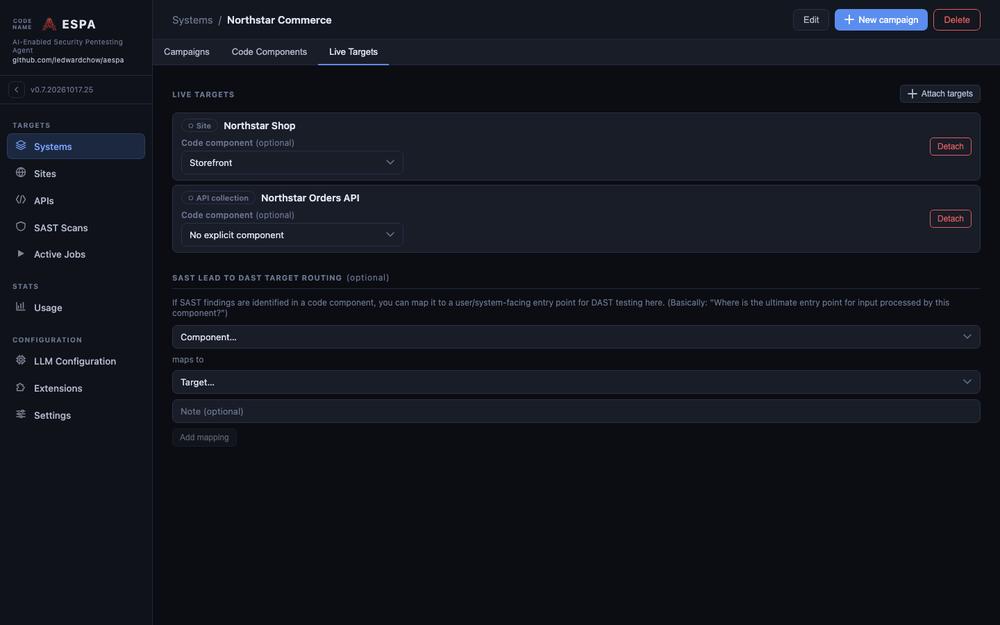

Sites list:
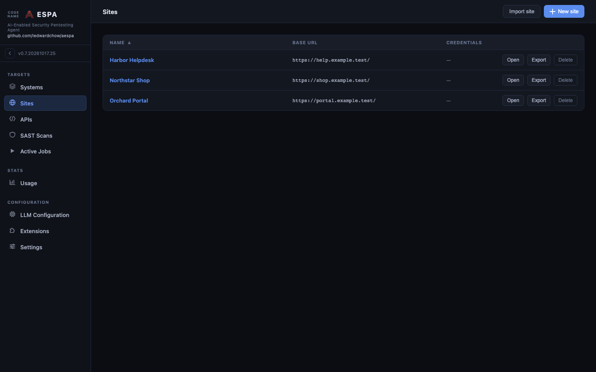

Web run setup, including crawl options and an optional LLM budget:
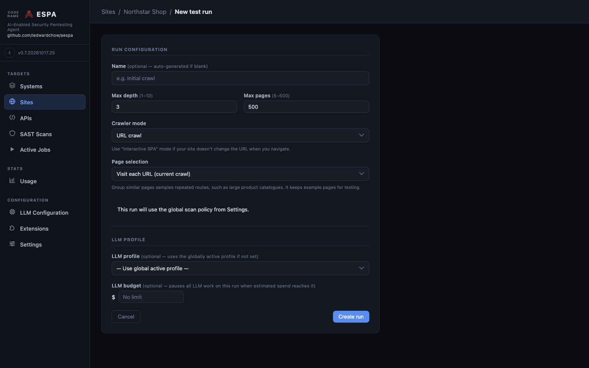

Site Map:
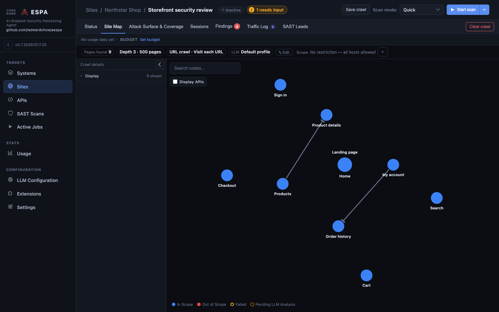

Attack Surface shows routes and their test coverage:
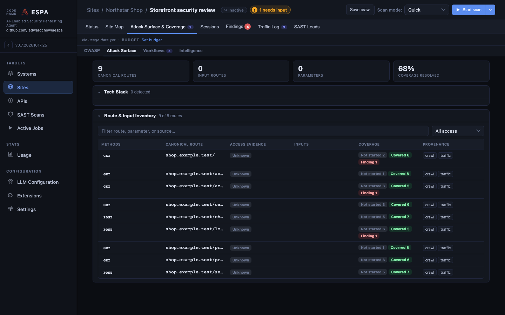

OWASP coverage for a web run:
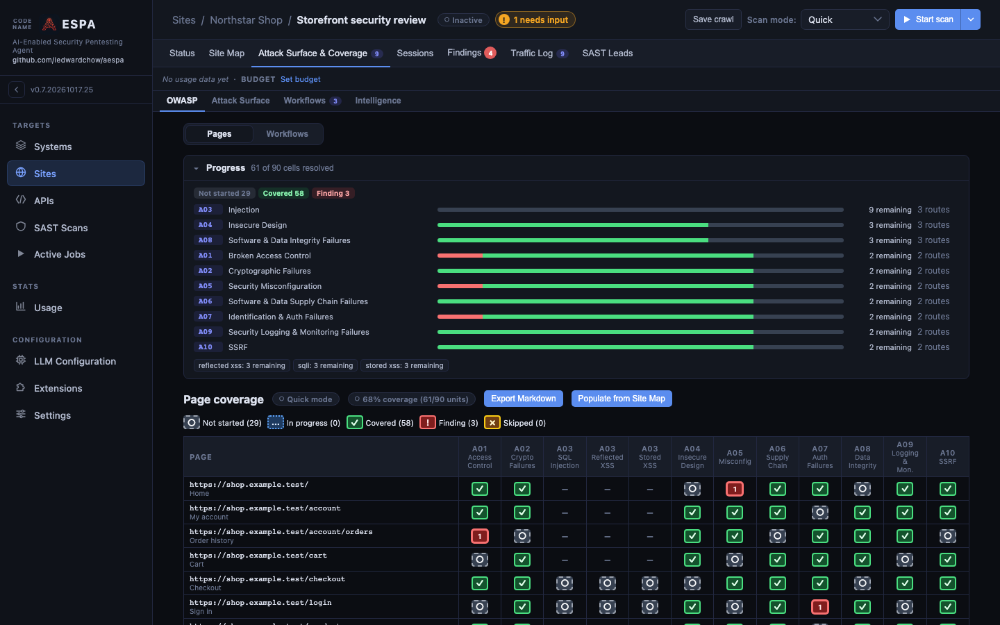

OWASP coverage for workflows:
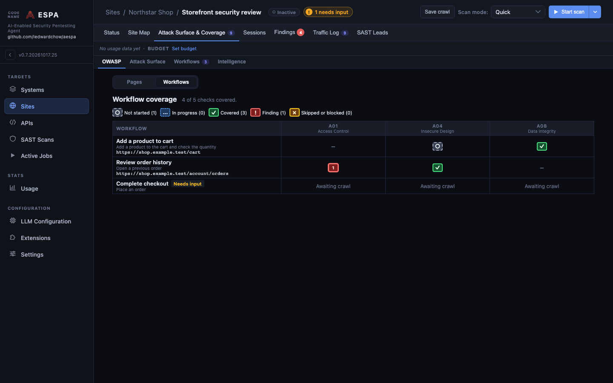

Workflows found during a crawl:
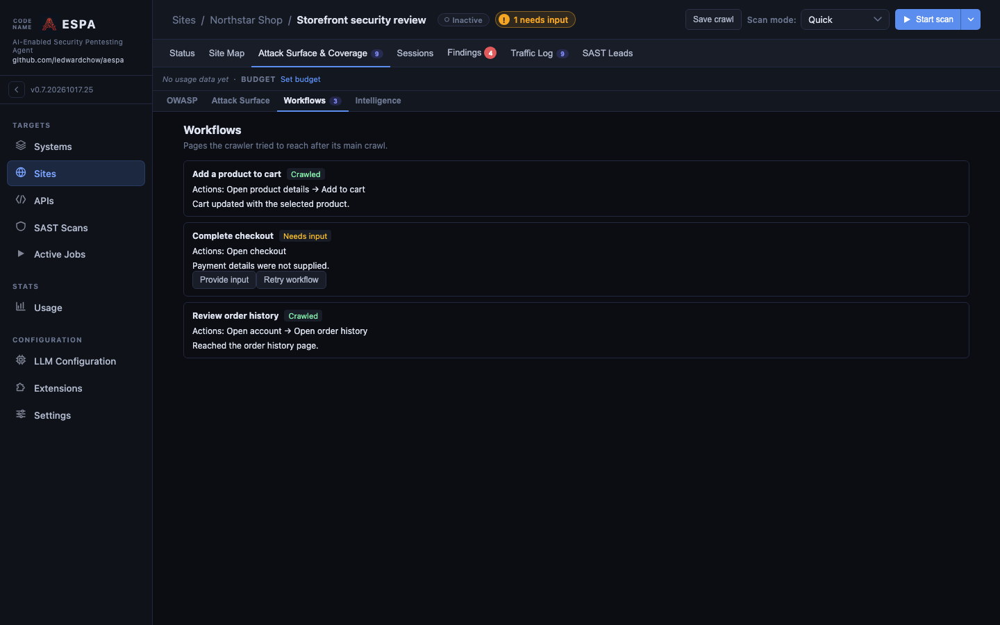

Web findings:
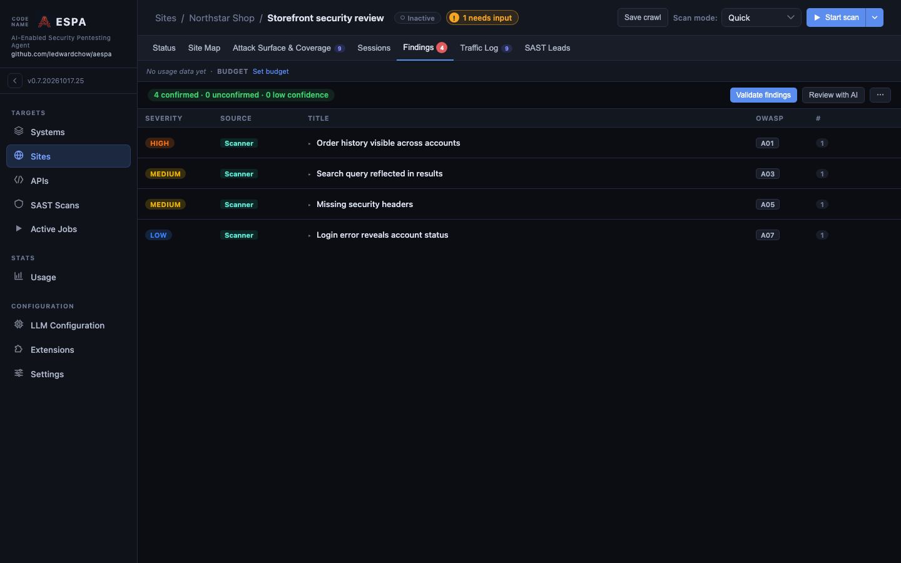

A.L.I.C.E. chat on a web run:
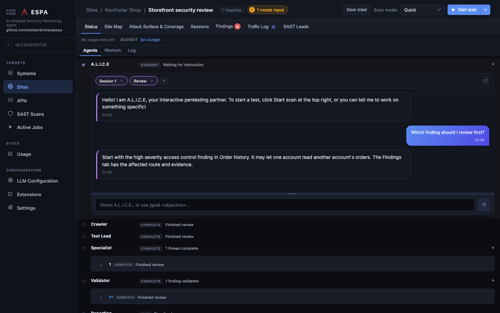

Endpoints parsed from an API document:
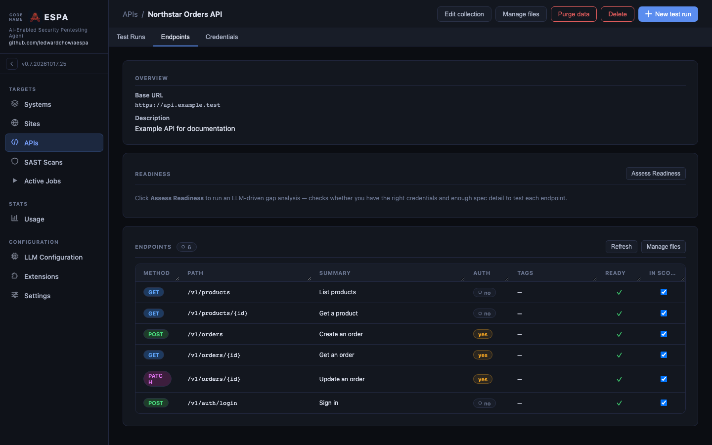

OWASP coverage for an API run:
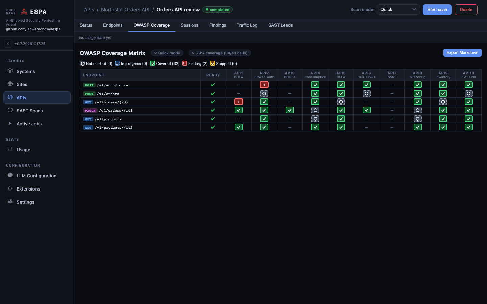

SAST scan setup:
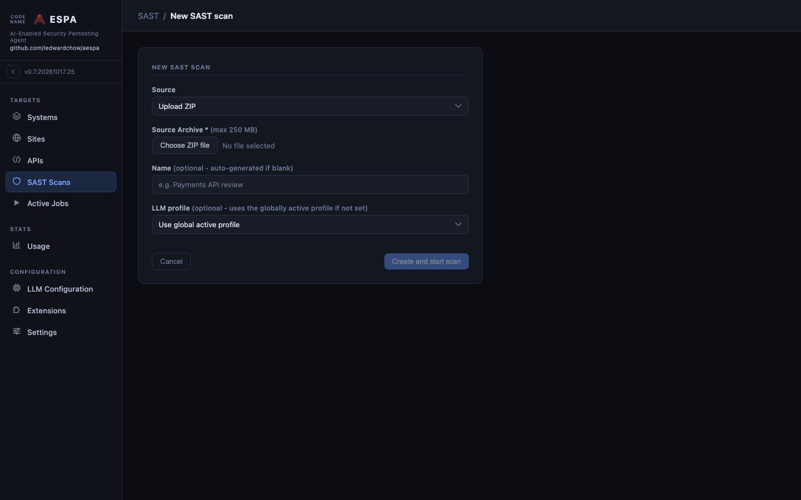

## Recommended models

- Claude Sonnet 4.6 - Doesn't seem to trigger refusals even without CVP.
- Sonnet 5 works about as well as 4.6 and doesn't trigger refusals.
- Opus 4.8 triggers refusals if not on CVP, but usually not immediately (it'll complete a "quick" mode scan most of the time)
- GPT 5.4/5.5/5.6 work well, but you need an account with Trusted Access or the scanner will terminate early/frequent refusals.
- Minimax M3
- GLM 5.2
